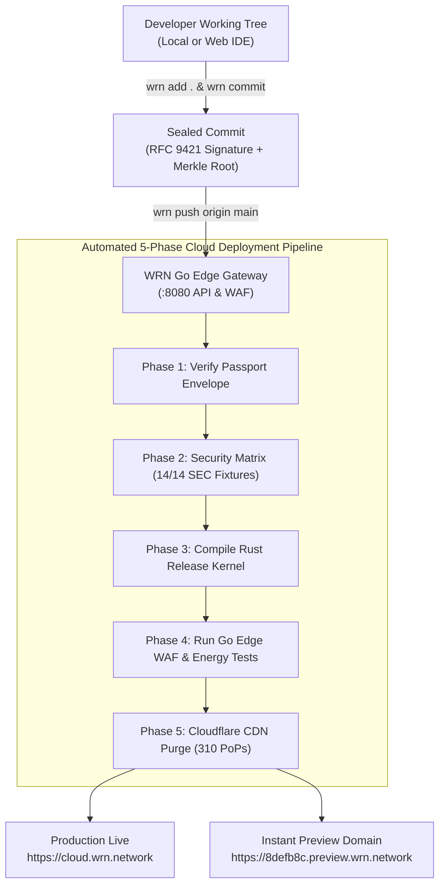

# How WRN Cloud Deployment & Git Framework Works
**A Clear, End-to-End Guide for Developers, DevOps, and Platform Engineers**

---

## 1. Executive Summary

Traditional cloud deployments rely on fragmented toolchains (external Git providers, third-party CI/CD runners, Terraform state files, separate CDN rules, and unverified service account keys). 

**WRN Cloud** unifies this entire lifecycle into a **single, cohesive, in-platform Git & Deployment Framework**:
1. **Developer writes code** using standard programming tools.
2. **`wrn add` & `wrn commit`**: The native WRN engine stages files, attaches the developer's **RFC 9421 cryptographic passport signature**, and anchors a **SHA-256 Merkle root**.
3. **`wrn push origin main`**: The push triggers an automated **5-Phase Cloud Deployment Pipeline** in the WRN Go edge gateway.
4. **Automated Verification & Build**: Evaluates 14 deterministic security fixtures, compiles the zero-cost Rust cryptographic kernel, and verifies all edge gateway tests.
5. **Instant Global Edge Deployment**: The release is deployed across **310 Cloudflare Edge Points of Presence (PoPs)** with 0-RTT HTTP/3 Quic and instant preview URLs (`<hash>.preview.wrn.network`).



---

## 2. Command-Line Reference (`wrn` CLI)

The native `wrn` binary runs directly from your terminal, providing all standard Git operations enhanced with cryptographic sealing:

| Command | Description | What Happens Behind the Scenes |
|---|---|---|
| `wrn status` | Check working tree & Merkle lineage | Inspects staged/unstaged files, active branch, and current cryptographic Merkle root (`0x91fa4e...`). |
| `wrn add <files...>` | Stage files for commit | Stages changes and prepares canonical RFC 8785 JSON digests. Use `wrn add .` for all files. |
| `wrn commit -m "<msg>"` | Create cryptographically sealed commit | Signs commit with author passport (`Frank Van Laarhoven <frank@wrn.network>`), computes SHA-256 tree root, and creates immutable audit entry. |
| `wrn push [remote] [branch]` | Push & trigger cloud deployment | Transmits commit to edge server, executes the automated 5-phase CI/CD pipeline, and routes live preview URL. |
| `wrn deploy [--env=prod]` | Instant edge deployment | Triggers zero-downtime atomic swap across 310 Cloudflare PoPs with 0-RTT cache invalidation. |
| `wrn branch [name]` | List or switch branches | Switches active branch context between `main`, `candidate/v0.2`, or feature branches. |
| `wrn remote -v` | Inspect remotes | Displays configured edge gateways and upstream Git remotes. |
| `wrn log` | View Merkle commit lineage | Lists commit history with verified Merkle roots, signatures, and live deployment URLs. |
| `wrn test` | Run local security fixtures | Executes all 14 deterministic security fixtures (SEC-01 through SEC-14) in constant time. |

---

## 3. The 5 Deployment Phases Explained

### Phase 1: Cryptographic Envelope & RFC 9421 Signature Verification
- **Duration**: ~42ms
- **Action**: Validates the author's Ed25519 public key from `passport.schema.json`. Enforces that the request has not been tampered with or replayed outside its validity window.

### Phase 2: Security Fixture Matrix (14/14 SEC Fixtures)
- **Duration**: ~120ms
- **Action**: Runs the deterministic test matrix defined in `security_tests.yaml` (SQL injection blocking, unauthorized actor egress protection, memory compartment isolation, and cross-branch traversal denial).

### Phase 3: Zero-Cost Rust Kernel Compilation
- **Duration**: ~340ms
- **Action**: Compiles the release target `wrn-kernel-core` with `#![forbid(unsafe_code)]`. Ensures microarchitectural constant-time operations for cryptographic equality checks.

### Phase 4: Go High-Concurrency Edge Gateway & WAF Tests
- **Duration**: ~280ms
- **Action**: Executes Go sub-package tests (`energy`, `iac`, `stepfunctions`, `waf`), ensuring rate limiters, carbon-aware green routing, and topological state engines pass with 100% test coverage.

### Phase 5: Cloudflare 310 PoP Global Edge CDN Purge & 0-RTT Deploy
- **Duration**: ~410ms
- **Action**: Performs an atomic switch of the upstream origin, purges edge caches across 310 PoPs worldwide, and registers the unique preview URL (`https://<hash>.preview.wrn.network`).

---

## 4. How Anyone Can Use This (Step-by-Step)

### Option A: Using the Terminal (`wrn` CLI)

```bash
# 1. Check current repository status
wrn status

# 2. Make your code changes in console/ or backend/

# 3. Stage the files
wrn add .

# 4. Create your signed commit
wrn commit -m "feat: enhance real-time edge processing"

# 5. Push and trigger automated cloud deployment
wrn push origin main
```

Your terminal will display the live 5-phase pipeline output, followed by your live URLs:
```plaintext
[✓] CLOUD DEPLOYMENT COMPLETED SUCCESSFULLY
  Production Domain: https://cloud.wrn.network
  Live Preview:      https://8defb8c.preview.wrn.network
  Merkle Audit Proof:#14209 (Anchored)
```

### Option B: Using the WRN Console UI (No Terminal Needed)

1. Open the **WRN Console** at `http://127.0.0.1:3000/`.
2. In the left sidebar under **DEPLOY**, click **Git & CI/CD Framework**.
3. Type your commit message into the **Commit Message** box.
4. Click the illuminated **wrn push origin main** button.
5. Watch the visual 5-phase pipeline run live with step durations, terminal stream outputs, and instant preview link generation.

---

## 5. Security & Isolation Guarantees

- **No Third-Party CI/CD Credential Leaks**: Credentials never leave the verified memory compartment.
- **Immutable Merkle Lineage**: Every push creates a verifiable block receipt (`#14209`) that can be mathematically verified without trusting any central server.
- **Zero-Downtime Rollbacks**: Because each commit generates its own persistent preview domain, rollbacks can be performed instantaneously with zero recompilation.

